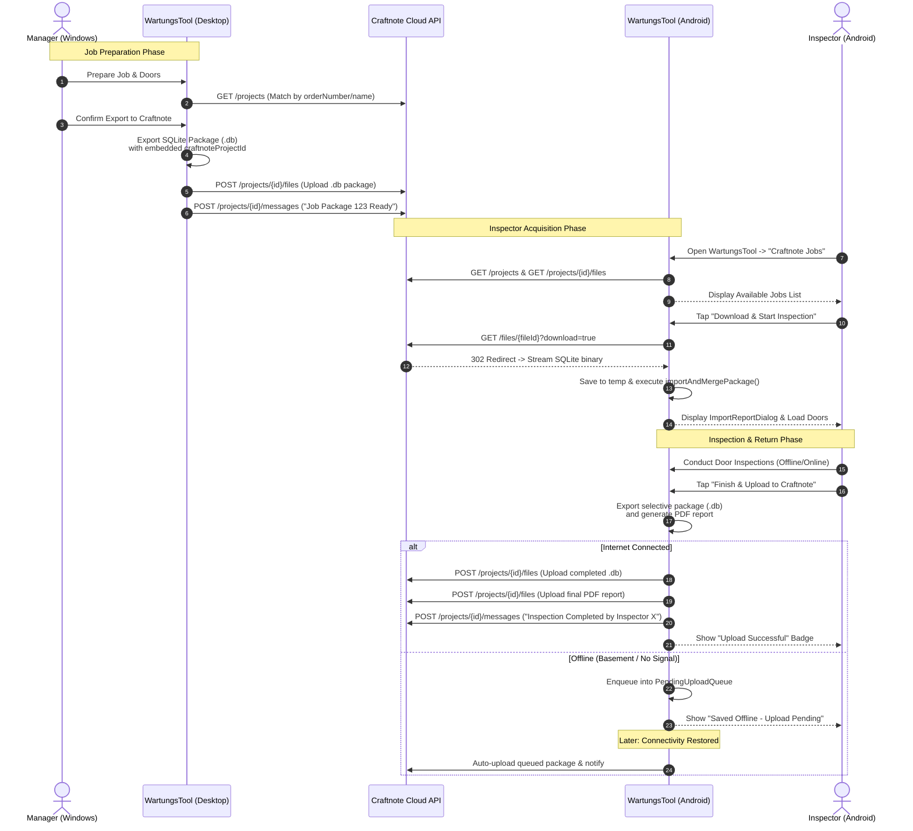
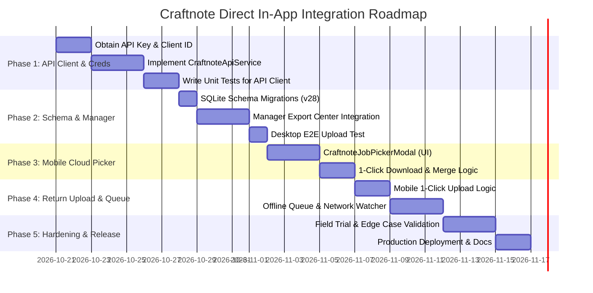

# Direct In-App Craftnote Integration: Implementation Specification & Strategic Plan

## 1. Executive Summary & Architectural Philosophy

The objective is to establish a seamless, bi-directional exchange of door inspection SQLite database packages (`.db`) between the **Manager** (Desktop/Windows) and the **Inspector** (Android Mobile) utilizing **Craftnote** purely as a cloud storage and collaboration backbone—**without requiring users to switch apps or rely on Android OS file-handling intents**.

### Why Direct In-App Sync is the Superior Approach
1. **Zero OS File Handler Ambiguity:** Android file associations for SQLite `.db` binaries (`application/octet-stream`, `application/x-sqlite3`) vary across Android OS versions and device manufacturers. By handling file download and upload directly within WartungsTool via REST API, the external Android OS file picker and app-switching are completely bypassed.
2. **Elimination of Multi-Step App Switching:** 
   * *Previous Flow (7 steps):* Open Craftnote $\rightarrow$ Find Project $\rightarrow$ Find File $\rightarrow$ Tap File $\rightarrow$ Choose "Open with" $\rightarrow$ WartungsTool opens $\rightarrow$ Inspect $\rightarrow$ Export to device $\rightarrow$ Open Craftnote $\rightarrow$ Upload file.
   * *Direct In-App Flow (2 steps):* Open WartungsTool $\rightarrow$ Tap "Download & Start" $\rightarrow$ Inspect $\rightarrow$ Tap "Upload to Craftnote".
3. **Deterministic Project Binding:** The Craftnote Project UUID (`craftnoteProjectId`) is injected directly into the exported SQLite package. When the inspector finishes, the app knows precisely where to upload without any manual folder selection.
4. **Offline Resilience:** Door inspections predominantly occur in basements, fire escape stairwells, and industrial facilities with zero network connectivity. An in-app sync engine queues completed inspections locally and automatically pushes them when internet access is restored.

---

## 2. End-to-End System Architecture & Data Flow



---

## 3. Craftnote Public API Contract & Technical Specifications

### 3.1 Base Configuration
* **Live Base URL:** `https://europe-west1-craftnote-live.cloudfunctions.net/api/v1`
* **Alternate Base URL:** `https://functions.craftnote.cloud/api/v1`
* **Authentication Header:** `X-CN-API-KEY: <COMPANY_API_KEY>`
* **Client Identification Header:** `X-CN-CLIENT-ID: <REGISTERED_CLIENT_ID>`
* **Content Types:** `application/json` for data endpoints, `multipart/form-data` for file uploads.

### 3.2 Key Endpoints Utilized

#### 1. Validate Authentication & Company Profile
* **Endpoint:** `GET /company/members/me`
* **Usage:** Used at setup or startup to verify the API key and fetch the active company context.
* **Response (200 OK):**
  ```json
  {
    "id": "Ka3gh32ashtQJuuas9",
    "name": "Carl-Friedrich",
    "lastname": "Gauss",
    "email": "cf@gauss.de"
  }
  ```

#### 2. Query Projects
* **Endpoint:** `GET /projects`
* **Parameters:** `limit=100`, `offset=0` (or `paginationMode=token&startAfter={id}`)
* **Usage:** Used by both Manager and Inspector to list open construction/facility projects.
* **Key Fields in Response:**
  * `id`: Project UUID (e.g. `03AE0AA1-B699-4A9C-85BE-30328897446B`).
  * `name`: Project Name (e.g. `Universitätsklinikum Haus 4`).
  * `orderNumber`: Corresponds to WartungsTool `jobNumber` or `projectNumber`.
  * `street`, `zipcode`, `city`: Facility address.
  * `archived`: Boolean flag.

#### 3. List Project Files
* **Endpoint:** `GET /projects/{projectId}/files`
* **Parameters:** `limit=100`
* **Usage:** Inspector checks for available `.db` files attached to the project.
* **Response Filtering:** Filter items where `type == "DOCUMENT"` and `name.endsWith('.db')`.
* **Key Fields:**
  * `id`: File UUID (e.g. `7811C21D-AC17-479F-9C2D-D6AC6AF0F1C0`).
  * `name`: File name (e.g. `Inspektion_2026_Auftrag_123.db`).
  * `creationTimestamp`: Unix epoch timestamp.

#### 4. Download File Binary
* **Endpoint:** `GET /files/{fileId}?download=true`
* **Behavior:** Returns HTTP `302 Found` with `Location` header directing to a signed Cloud Storage URL, or directly streams the binary data.
* **HTTP Client Handling:** The Dart `http` or `dio` client must enable `followRedirects: true` to seamlessly stream bytes directly to disk.

#### 5. Upload File (Inspection Package & Reports)
* **Endpoint:** `POST /projects/{projectId}/files`
* **Encoding:** `multipart/form-data`
* **Form Fields:**
  * `type`: `"DOCUMENT"` (Required string)
  * `name`: File display name (e.g. `Inspektion_ABGESCHLOSSEN_Auftrag_123.db`)
  * `folderId`: (Optional) UUID of target subfolder (e.g., "01_Wartung")
  * `data`: Binary payload of the file (`application/octet-stream` or `application/pdf`)
* **Response (200 OK):** Returns the created `File` object metadata.

#### 6. Post Status Notification in Project Chat
* **Endpoint:** `POST /projects/{projectId}/messages`
* **Payload:**
  ```json
  {
    "content": "📌 Wartungstool Update: Prüfpaket für Auftrag 2026-042 wurde durch Max Mustermann erfolgreich hochgeladen."
  }
  ```

---

## 4. Database Schema Evolutions

To persist the linkage between local inspections and remote Craftnote entities, the SQLite schemas in both [DatabaseService](file:///c:/Users/cabarcas/Projects/WartungsTool/lib/services/database_service.dart) (Master DB) and [LocalDatabaseService](file:///c:/Users/cabarcas/Projects/WartungsTool/lib/services/local_database_service.dart) (`working.db`) require schema extensions.

### 4.1 Table Schema Alterations: `inspections`
Add the following columns to `inspections`:
```sql
ALTER TABLE inspections ADD COLUMN craftnoteProjectId TEXT;
ALTER TABLE inspections ADD COLUMN craftnoteFileId TEXT;
ALTER TABLE inspections ADD COLUMN craftnoteSyncStatus TEXT DEFAULT 'none';
ALTER TABLE inspections ADD COLUMN craftnoteLastSyncTime TEXT;
```

### 4.2 Status Enum: `CraftnoteSyncStatus`
```dart
enum CraftnoteSyncStatus {
  none,              // Not linked to Craftnote
  readyForDownload,  // Available in cloud
  downloaded,        // Imported into working.db
  inProgress,        // Door inspection in progress
  pendingUpload,     // Inspection completed, waiting for network
  uploaded,          // Successfully synced back to Craftnote
}
```

### 4.3 Pending Upload Queue Table (Mobile `working.db`)
To reliably handle offline work:
```sql
CREATE TABLE IF NOT EXISTS craftnote_upload_queue (
  id INTEGER PRIMARY KEY AUTOINCREMENT,
  inspectionId INTEGER,
  craftnoteProjectId TEXT NOT NULL,
  packageFilePath TEXT NOT NULL,
  pdfFilePath TEXT,
  queuedAt TEXT NOT NULL,
  attempts INTEGER DEFAULT 0,
  lastError TEXT
);
```

---

## 5. Component Implementation Details

### 5.1 Service Layer: `CraftnoteApiService`
* **Location:** `lib/services/craftnote_api_service.dart`
* **Responsibilities:**
  * Encapsulates all REST calls with proper error handling, timeout management (30s default), and retry logic.
  * Manages credentials retrieval from secure settings.

```dart
// Conceptual structure of lib/services/craftnote_api_service.dart
class CraftnoteApiService {
  static const String defaultBaseUrl = 'https://europe-west1-craftnote-live.cloudfunctions.net/api/v1';

  final http.Client _client;
  String? _apiKey;
  String? _clientId;
  String _baseUrl;

  CraftnoteApiService({
    http.Client? client,
    String? apiKey,
    String? clientId,
    String baseUrl = defaultBaseUrl,
  }) : _client = client ?? http.Client(),
       _apiKey = apiKey,
       _clientId = clientId,
       _baseUrl = baseUrl;

  Map<String, String> get _headers => {
    'X-CN-API-KEY': _apiKey ?? '',
    if (_clientId != null && _clientId!.isNotEmpty) 'X-CN-CLIENT-ID': _clientId!,
    'Accept': 'application/json',
  };

  Future<bool> validateConnection() async;
  Future<List<CraftnoteProject>> getProjects({int limit = 100, int offset = 0});
  Future<List<CraftnoteFile>> getProjectFiles(String projectId);
  Future<File> downloadFile(String fileId, String destinationPath);
  Future<CraftnoteFile> uploadFile({
    required String projectId,
    required File file,
    required String fileName,
    String? folderId,
  });
  Future<void> postMessage(String projectId, String message);
}
```

### 5.2 Sync Controller Layer: `CraftnoteSyncService`
* **Location:** `lib/services/craftnote_sync_service.dart`
* **Responsibilities:**
  * Coordinates between `CraftnoteApiService`, `LocalDatabaseService`, and `FileExportHelper`.
  * **Download Workflow:**
    1. Downloads remote file to temporary directory.
    2. Runs schema compatibility check.
    3. Invokes `LocalDatabaseService.importAndMergePackage(tempPath)`.
    4. Updates `craftnoteSyncStatus = 'downloaded'`.
    5. Returns `ImportReport` for UI rendering.
  * **Upload Workflow:**
    1. Triggers selective export via `LocalDatabaseService.exportSelectiveJobPackage()`.
    2. Optional: Invokes `PdfExportService.exportSingleInspectionPdf()`.
    3. If online: uploads files sequentially via `uploadFile()` and posts chat notification.
    4. If offline: adds entry to `craftnote_upload_queue`.
  * **Background Queue Processor:** Listens to connectivity changes via `connectivity_plus` and drains queued uploads when internet is detected.

### 5.3 Manager Desktop UI Extensions
* **File:** `lib/widgets/export_center_dialog.dart`
  * Add a new Export Scope / Destination option:
    `[ x ] Direkt zu Craftnote Projekt übertragen`
  * When selected, loads project list from `CraftnoteApiService.getProjects()`.
  * Auto-selects project if `craftnoteProject.orderNumber == inspection.jobNumber`.
  * On "Exportieren", executes `DatabaseService.exportJobPackage()`, uploads binary to Craftnote, writes a log message, and shows a confirmation with direct link.
* **File:** `lib/widgets/craftnote_settings_dialog.dart` (New)
  * Accessible from Manager Dashboard / Settings.
  * Inputs for:
    * `Craftnote API Key` (Password masked with reveal toggle).
    * `Craftnote Client ID`.
    * Default folder name in Craftnote (e.g. `01_Wartungsberichte`).
    * "Verbindung testen" button displaying user name and company name upon successful test.

### 5.4 Inspector Mobile UI Extensions
* **File:** `lib/pages/DoorListPage.dart` / `lib/pages/job_selection_page.dart`
  * Add a prominent **"Craftnote Cloud"** action button in the AppBar / Floating Action Bar.
  * Opens the **`CraftnoteJobPickerModal`**:
    * Lists all active Craftnote projects containing `.db` packages.
    * Displays metadata: Project Title, Address, File Date, File Size.
    * Action: **"Herunterladen & Starten"** (1-Click).
    * Automatically runs import and opens the door inspection list.
  * In the Bottom Bar / Drawer of `DoorListPage`:
    * Add button: **"Inspektion abschließen & zu Craftnote senden"**.
    * Performs validation check (warns if unprocessed doors exist via `confirmUnprocessedDoors`).
    * Displays upload spinner and success badge.
    * If offline, changes button to **"Offline gespeichert (Upload ausstehend)"** with an amber sync icon.

---

## 6. Offline Queue & Network Resilience

Inspections in concrete basement facilities, nuclear shelters, or elevator shafts frequently lack any wireless network. The architecture guarantees zero data loss:

1. **State Persistence:**
   The `craftnote_upload_queue` table in SQLite retains:
   * Absolute path of the exported `.db` package.
   * Absolute path of the PDF report (if generated).
   * Target `craftnoteProjectId`.
   * Timestamp and retry count.
2. **Connectivity Listener:**
   Using `connectivity_plus`:
   ```dart
   Connectivity().onConnectivityChanged.listen((ConnectivityResult result) {
     if (result != ConnectivityResult.none) {
       CraftnoteSyncService.processPendingQueue();
     }
   });
   ```
3. **User Feedback:**
   A discreet banner at the top of the app:
   `"1 Inspektion wartet auf Upload (Keine Internetverbindung)"` with a manual `"Jetzt synchronisieren"` retry button.

---

## 7. Security & Key Management

1. **Storage of API Credentials:**
   * **Windows Desktop (Manager):** Stored in local app configuration directory or encrypted credentials file via `flutter_secure_storage`.
   * **Android Mobile (Inspector):**
     * Option A (Recommended for simplicity): The company API Key is entered once during tablet setup in the Settings dialog and stored in Android `EncryptedSharedPreferences` via `flutter_secure_storage`.
     * Option B (Zero-Config for Inspectors): The Manager's desktop app can embed a temporary sync token or the Manager pre-configures devices via a simple QR code scan containing the company API Key.
2. **Role Restrictions:**
   The API Key requires administrative rights in Craftnote to create and manage files across all projects.

---

## 8. Strategic Execution Plan & Milestones



### Milestone Breakdown

#### Phase 1: Foundations & API Client (Days 1–5)
* [ ] Generate company API Key in Craftnote Web portal (`Settings -> API Keys`).
* [ ] Send request to `schnittstelle@craftnote.de` for `X-CN-CLIENT-ID` registration.
* [ ] Create `lib/services/craftnote_api_service.dart` with full OpenAPI coverage for `/company`, `/projects`, `/files`, `/messages`.
* [ ] Add unit tests simulating API responses (mock client).

#### Phase 2: Schema Migrations & Manager Desktop Upload (Days 6–10)
* [ ] Update `DatabaseService` (version increment to 28) with `craftnoteProjectId` column.
* [ ] Update `LocalDatabaseService` (version increment to 18).
* [ ] Enhance `ExportCenterDialog` to allow direct Craftnote upload.
* [ ] Verify exported `.db` package contains the bound `craftnoteProjectId`.

#### Phase 3: Mobile Job Discovery & 1-Click Import (Days 11–15)
* [ ] Create `CraftnoteJobPickerModal` in `lib/widgets/craftnote_job_picker_modal.dart`.
* [ ] Wire download routine: Download $\rightarrow$ Verify $\rightarrow$ `importAndMergePackage` $\rightarrow$ Open `DoorListPage`.
* [ ] Test with multiple packages in different Craftnote folders.

#### Phase 4: Mobile Return Upload & Offline Queue (Days 16–20)
* [ ] Add "Finish & Upload to Craftnote" button in `DoorListPage`.
* [ ] Implement `craftnote_upload_queue` table and worker in `CraftnoteSyncService`.
* [ ] Test offline behavior (airplane mode during completion $\rightarrow$ reconnection auto-sync).

#### Phase 5: Field Hardening & Documentation (Days 21–25)
* [ ] Test large DB packages (500+ doors, error catalogs, photos).
* [ ] Verify error dialogs for rate limits, network timeouts, or invalid API keys.
* [ ] Provide concise user guide for managers and technicians.

---

## 9. Immediate Next Actions

To proceed with implementation, the following initial steps are ready to be triggered:
1. **Acquire Credentials:** Obtain the Craftnote API Key from the company admin portal and register the Client ID via email.
2. **Create the Base Service:** Implement `lib/services/craftnote_api_service.dart` in the codebase.
3. **Upgrade Database Version:** Apply migration adding `craftnoteProjectId` to SQLite tables.
