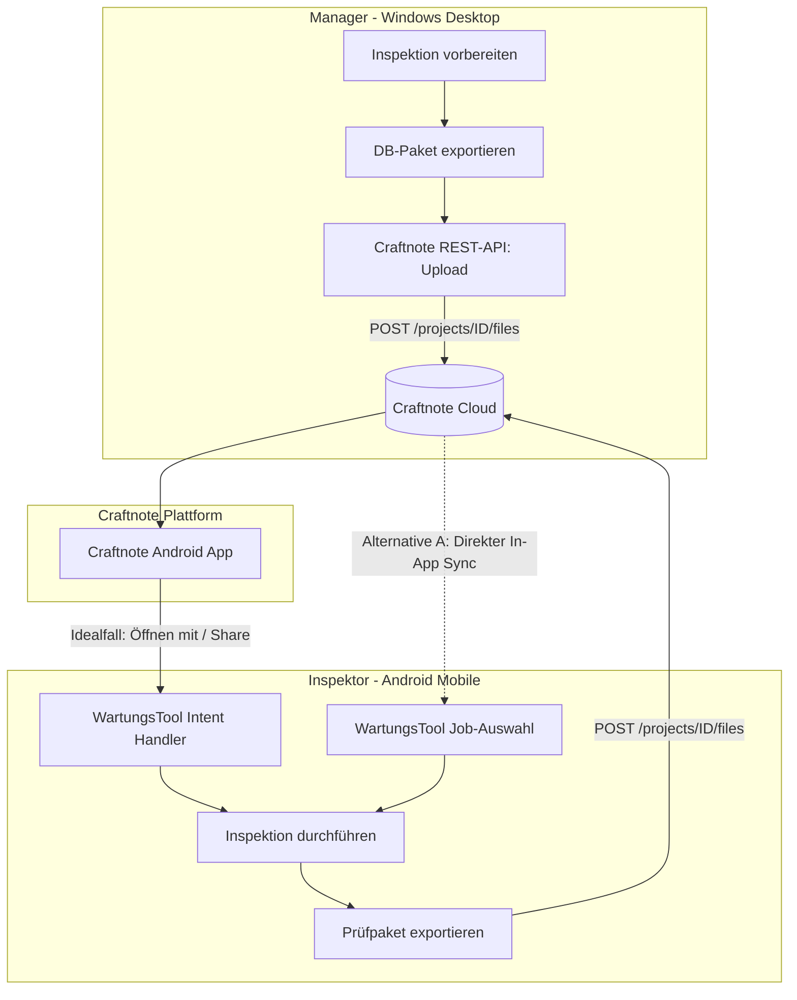
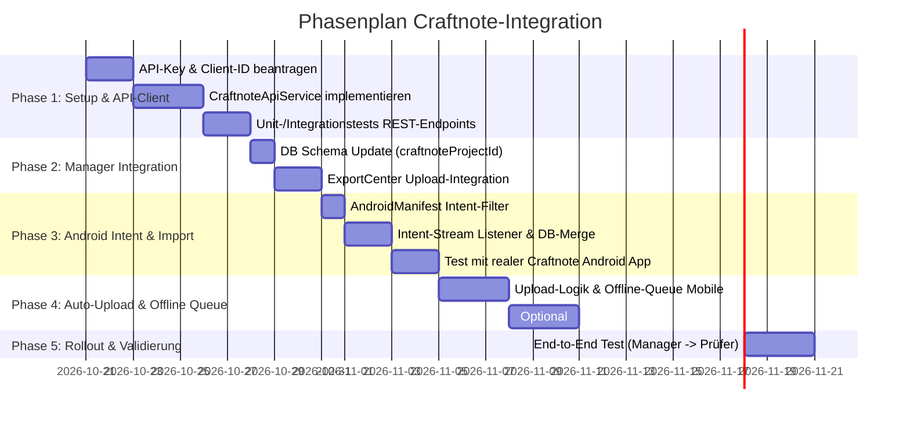

# Machbarkeitsanalyse & Implementierungsstrategie: Craftnote API-Integration für WartungsTool

Dieses Dokument liefert eine fundierte Analyse zur Anbindung von **Craftnote** als Datenaustausch-Plattform für Inspektionspakete (`.db`-Dateien) zwischen dem **Manager** (Desktop/Windows) und dem **Prüfer / Inspektor** (Android Mobile).

---

## 1. Executive Summary & Machbarkeitsbewertung

| Anforderung / Workflow-Schritt | Status / Machbarkeit | Technische Grundlage & Bewertung |
| :--- | :---: | :--- |
| **1. Manager: Job exportieren & via Craftnote API hochladen** | **100% Machbar** | REST-Endpoint `POST /projects/{projectId}/files` (Multipart/Form-Data). Vollständig dokumentiert und stabil. |
| **2. Inspektor: Direktes Öffnen aus Craftnote App auf Android (Idealfall)** | **Bedingt Machbar (Sehr hoch)** | Technisch über Android OS `Intent-Filter` (`ACTION_VIEW` / `ACTION_SEND`) möglich. Abhängig davon, ob die Craftnote Android-App bei `.db`-Dateien die Aktion *„Öffnen mit...“* oder *„Teilen“* anbietet. |
| **3. Inspektor: Auto-Upload des fertigen Prüfpakets an Craftnote** | **100% Machbar** | Direkter Aufruf von `POST /projects/{projectId}/files` aus dem WartungsTool heraus. Offline-Queue für Arbeiten im Keller/Funkloch erforderlich. |
| **4. Empfohlene Alternative: Direct In-App Cloud Sync** | **Optimaler Workflow** | WartungsTool lädt Pakete direkt über die Craftnote API in der App herunter (1-Klick). Umgeht den App-Wechsel zu Craftnote komplett. |

---

## 2. Detaillierte Analyse der einzelnen Schritte



---

### Schritt 1: Manager bereitet Job vor und lädt DB-Paket hoch
* **Bestehender Status in WartungsTool:**
  * Der Manager selektiert Aufträge in der Desktop-App (`MasterDoorsPage`, `CreateProjectDialog` oder `ExportCenterDialog`).
  * `DatabaseService.exportJobPackage([inspectionIds])` generiert eine kompakte SQLite-Datei (z. B. `Inspektion_2026_Auftrag_123.db`).
* **Craftnote API-Interaktion:**
  * **Authentifizierung:** HTTP-Header `X-CN-API-KEY: <COMPANY_KEY>` (und optional `X-CN-CLIENT-ID`).
  * **Projekt-Zuordnung:**
    * `GET /projects`: Durchsuchen nach Projekten (Filter nach `orderNumber` entsprechend der WartungsTool-`jobNumber` oder `projectNumber`).
    * Falls Projekt noch nicht existiert: `POST /projects` zur automatischen Neuanlage inkl. Kundenadresse und Ansprechpartner.
  * **Datei-Upload:**
    * `POST /projects/{projectId}/files` als `multipart/form-data`:
      * `type`: `"DOCUMENT"`
      * `name`: `Inspektion_Auftrag_123.db`
      * `data`: Binärdaten der `.db`-Datei
      * `folderId`: (Optional) ID eines Unterordners wie *„01_Wartungsdaten“*.
  * **Projekt-Chat:**
    * `POST /projects/{projectId}/messages` zur automatischen Benachrichtigung: *„Neues Prüfpaket für Auftrag 123 hochgeladen.“*
* **Ergebnis:** **Vollständig machbar ohne Hindernisse.**

---

### Schritt 2: Inspektor öffnet DB-Datei direkt aus Craftnote auf Android (Idealfall)

#### Wie Android Datei-Interaktionen zwischen Apps handhabt:
Wenn ein Prüfer in der Craftnote Android-App eine Datei antippt, prüft Craftnote, ob es die Datei selbst anzeigen kann (z. B. PDF oder Bilder). Bei Datenbankdateien (`.db`) kann Craftnote dies nativ nicht.
Standard-Android-Apps lösen in diesem Fall einen System-Intent aus:
1. Entweder `android.intent.action.VIEW` (Datei betrachten/öffnen)
2. Oder über das Kontextmenü (3 Punkte) `android.intent.action.SEND` (Datei teilen mit anderer App).

Hierbei übergibt Craftnote eine temporäre Inhalts-URI:
`content://de.craftnote.app.fileprovider/.../Inspektion_123.db`

#### Was im WartungsTool dafür implementiert werden muss:
1. **`AndroidManifest.xml` Intent-Filter:**
   ```xml
   <!-- Empfang von .db-Dateien via "Öffnen mit" -->
   <intent-filter>
       <action android:name="android.intent.action.VIEW" />
       <category android:name="android.intent.category.DEFAULT" />
       <category android:name="android.intent.category.BROWSABLE" />
       <data android:scheme="content" />
       <data android:mimeType="application/octet-stream" />
       <data android:mimeType="application/x-sqlite3" />
       <data android:mimeType="*/*" />
       <data android:pathPattern=".*\\.db" />
   </intent-filter>

   <!-- Empfang von .db-Dateien via "Teilen / Senden an" -->
   <intent-filter>
       <action android:name="android.intent.action.SEND" />
       <category android:name="android.intent.category.DEFAULT" />
       <data android:mimeType="*/*" />
   </intent-filter>
   ```
2. **Flutter Intent-Handling (z. B. via `app_links` oder `receive_sharing_intent`):**
   * App startet mit Intent oder fängt Intent im laufenden Betrieb ab.
   * WartungsTool liest den Stream aus der `content://`-URI über den Android `ContentResolver`.
   * Die Datei wird temporär im App-Cache abgelegt (z. B. `cache/incoming_job.db`).
   * `LocalDatabaseService.importAndMergePackage(incomingPath)` wird aufgerufen.
   * Das `ImportReportDialog` wird angezeigt und der Auftrag steht sofort offline zur Verfügung.

#### Risiken & Grenzen des Idealfalls:
* **Proprietäres Verhalten der Craftnote Android-App:**
  Die Craftnote API dokumentiert ausschließlich Server-Endpoints, nicht das Verhalten der proprietären Android-UI.
  Falls die Craftnote-App beim Antippen einer `.db`-Datei lediglich eine Fehlermeldung wie *„Format kann nicht angezeigt werden“* ausgibt und kein System-Menü für *„Öffnen mit...“* anbietet, muss der Prüfer auf die 3 Punkte tippen und *„Teilen“* bzw. *„In anderer App öffnen“* wählen.
* **MIME-Type Inkonsistenzen:**
  Manche Android-Dateimanager senden `.db`-Dateien als `application/octet-stream`, andere als `application/x-sqlite3` oder `*/*`. Der Intent-Filter muss daher tolerant konfiguriert sein.

---

### Schritt 3: Inspektor schließt Inspektion ab & automatischer Upload zu Craftnote

* **Herausforderung:** Woher weiß die Inspektor-App, in welches Craftnote-Projekt die fertige Datenbank hochgeladen werden soll?
* **Lösung:**
  * Wenn der Manager das Paket in Schritt 1 schnürt, wird die `craftnoteProjectId` (UUID) direkt in die `inspections`-Tabelle der exportierten `.db` geschrieben (Feld: `craftnoteProjectId`).
  * Nach der Prüfung liest das WartungsTool diese ID direkt aus der lokalen SQLite-Datenbank aus.
* **Upload-Logik:**
  * Das WartungsTool erzeugt das finale Export-Paket (`LocalDatabaseService.exportWorkingDb(...)`).
  * Aufruf von `POST /projects/{craftnoteProjectId}/files`:
    * Dateiname: `Inspektion_ABGESCHLOSSEN_Auftrag_123_20261020.db`
    * Zusätzlich kann der fertige GAEB-Prüfbericht oder ein PDF-Export direkt mit hochgeladen werden!
* **Umgang mit Offline-Situationen (Funklöcher, Kellerräume):**
  * Prüfungen finden sehr häufig in brandgeschützten Kellern oder Tiefgaragen ohne Mobilfunkempfang statt.
  * **Zwingend erforderlich: Eine Pending-Upload-Queue.**
    * Wenn offline: Status auf `pending_sync` setzen.
    * Sobald wieder eine Internetverbindung besteht (überprüft per `connectivity_plus` oder beim nächsten App-Start), wird das Paket automatisch im Hintergrund hochgeladen.
* **Ergebnis:** **100% Machbar.**

---

## 3. Alternative & Workaround-Strategien

### Alternative A: Direct In-App Cloud Sync (Bester Gesamt-Workflow)
Statt den Prüfer zwischen zwei Apps (Craftnote $\leftrightarrow$ WartungsTool) hin- und herwechseln zu lassen:
1. Im WartungsTool auf der `JobSelectionPage` gibt es einen Reiter **„Craftnote Cloud-Aufträge“** (analog zum bereits bestehenden Kinchi-Service).
2. Das WartungsTool fragt über die Craftnote API die zugewiesenen Projekte und Dateien ab:
   * `GET /projects` (oder Projekte, in denen der Prüfer Mitglied ist via `GET /projects/{id}/members`).
   * `GET /projects/{id}/files` (filtert nach `.db`-Dateien).
3. Der Prüfer sieht eine saubere Auftragsliste direkt im WartungsTool:
   * *Auftrag 2026-042: Brandabschnitt Nord – Bereit zum Herunterladen*
4. Ein Klick auf **„Herunterladen & Starten“** lädt die Datei via `GET /files/{fileId}?download=true` herunter und importiert sie nahtlos.
5. Nach Abschluss: Ein Klick auf **„Synchronisieren & Abschließen“** lädt alles hoch.
* **Vorteile:**
  * **Null Abhängigkeit** von der Craftnote-Android-App oder deren Intent-Verhalten.
  * Keine Verwirrung durch Android-Dateidialoge.
  * Schneller, robuster und vollständig automatisierbar.
  * **Hinweis:** Alternative A und der Idealfall (Intent-Filter) schließen sich nicht aus! Beide können parallel implementiert werden.

### Alternative B: Intent-Filter + Android Share Sheet Fallback
* Falls kein API-Key auf dem Mobilgerät hinterlegt werden soll:
  * Beim Import: Datei über „Teilen mit WartungsTool“ empfangen.
  * Beim Export: WartungsTool öffnet den nativen Android-Share-Sheet (`share_plus`) und der Prüfer wählt die Craftnote-App als Ziel aus.

---

## 4. Lizenzierung, Berechtigungen & Craftnote-Voraussetzungen

1. **Craftnote Lizenzmodell:**
   * Craftnote stellt seine REST-API standardmäßig ohne gesonderte API-Gebühren bereit.
   * **Voraussetzung:** Es wird ein bezahlter Firmenaccount benötigt (Tarifstufe *„Büro“* bzw. *„Pro/Premium“*). In kostenlosen Basis-Accounts ist die API-Verwaltung in der Regel nicht freigeschaltet.
2. **API-Key Erstellung:**
   * Kann in der Craftnote Web-App unter `Einstellungen -> Schnittstelle / API-Keys` von einem Firmeninhaber / Administrator erzeugt werden.
3. **Client-ID Registrierung:**
   * Laut Craftnote-Dokumentation verlangt die API künftig neben dem `X-CN-API-KEY` auch eine Client-ID (`X-CN-CLIENT-ID`), die per Mail bei `schnittstelle@craftnote.de` beantragt werden muss. Dies sollte frühzeitig angefragt werden.
4. **Berechtigungen:**
   * Der API-Key erbt die Rechte des Erstellers (Inhaber/Admin).
   * Damit können alle Projekte, Ordner und Dateien des Unternehmens verwaltet werden.

---

## 5. Was muss im WartungsTool implementiert werden?

### A. Core Service (`lib/services/craftnote_api_service.dart`)
Implementierung eines typsicheren REST-Clients:
* `getProjects({int offset, int limit})`
* `getProjectFiles(String projectId)`
* `downloadFile(String fileId, String targetPath)` (folgt dem 302-Redirect)
* `uploadProjectFile(String projectId, File file, {String? folderId, String? fileName})` (Multipart-Upload)
* `postProjectMessage(String projectId, String text)`
* `validateApiKey(String apiKey)` (über `GET /company/members/me`)

### B. Datenbankschema-Erweiterung (`DatabaseService` & `LocalDatabaseService`)
* Erweiterung der `inspections`-Tabelle um zwei optionale Spalten:
  * `craftnoteProjectId TEXT`
  * `craftnoteFileId TEXT`
* Sicherstellung, dass diese Felder beim `exportJobPackage` mit in die SQLite-Datei geschrieben werden.

### C. Manager UI (Desktop / Windows)
* **Einstellungen-Dialog:** Hinterlegung von Craftnote API-Key & Client-ID.
* **ExportCenterDialog / CreateProjectDialog:**
  * Checkbox: *„Direkt an Craftnote übertragen“*.
  * Auswahl des Craftnote-Zielprojekts (automatisch per Auftragsnummer vorgefiltert).
  * Automatischer Upload nach Paketerstellung.

### D. Inspektor Mobile UI & Android OS (Android)
* **`android/app/src/main/AndroidManifest.xml`:**
  * Deklaration der `<intent-filter>` für `.db`-Dateien und `content://`-URIs.
* **App-Start / Lifecycle-Handler (`main.dart`):**
  * Listener für eingehende Intents beim Start oder Resume.
  * Automatischer Aufruf von `LocalDatabaseService.importAndMergePackage()`.
* **Sync- & Upload-Button in `JobSelectionPage` & `InspectionDoorsPage`:**
  * Schaltfläche *„An Craftnote hochladen“*.
  * Status-Indikator (Synchronisiert / Ausstehend / Fehler).
  * Offline-Queue-Management.

---

## 6. Phasenweiser Ausführungsplan (Execution Plan)



### Phase 1: Vorbereitung & Basis-Service (Tag 1–5)
1. Firmen-API-Key in Craftnote generieren.
2. E-Mail an `schnittstelle@craftnote.de` zur Vergabe einer `X-CN-CLIENT-ID`.
3. Erstellung des `CraftnoteApiService` in `lib/services/craftnote_api_service.dart`.
4. Verbindungstest über `GET /company/members/me`.

### Phase 2: Manager Export & Upload (Tag 6–8)
1. Hinzufügen der Spalte `craftnoteProjectId` in `DatabaseService` und `LocalDatabaseService`.
2. UI-Erweiterung im `ExportCenterDialog`: Auswahl des Craftnote-Projekts und Upload-Button.
3. Test des Uploads von Test-DB-Paketen in einen Test-Ordner in Craftnote.

### Phase 3: Android Intent Handling & Import (Tag 9–11)
1. Konfiguration von `AndroidManifest.xml` für `.db`-Intents.
2. Einbindung von `app_links` oder `receive_sharing_intent`.
3. Kopieren des empfangenen Streams aus `content://` in den lokalen App-Speicher.
4. Automatischer Import via `importAndMergePackage()`.
5. Praxistest auf einem realen Android-Testgerät mit installierter Craftnote-App.

### Phase 4: Auto-Upload & Direct Cloud Sync (Tag 12–16)
1. Auto-Upload der fertigen Inspektion nach Abschluss.
2. Implementierung des Offline-Status (`pending_sync`).
3. Bereitstellung der direkten Projektliste in `JobSelectionPage` (Alternative A).

### Phase 5: Qualitätssicherung & Schulung (Tag 17–19)
1. End-to-End Durchlauf: Manager erstellt Paket $\rightarrow$ Übertragung $\rightarrow$ Prüfer öffnet Paket $\rightarrow$ Prüfung $\rightarrow$ Upload $\rightarrow$ Manager sichtet Ergebnis.
2. Validierung von Edge Cases (Verbindungsabbrüche, gleichzeitige Bearbeitung, Namenskonflikte).

---

## 7. Benötigte Ressourcen & Informationen zur weiteren Schärfung

1. **Craftnote Client-ID:**
   * Kurze Kontaktaufnahme mit `schnittstelle@craftnote.de` mit Bitte um Ausstellung einer Client-ID für das Inhouse-Tool „WartungsTool“.
2. **Prüfung des Craftnote-Tarifs:**
   * Sicherstellen, dass das Unternehmen mindestens das Paket *„Büro“* gebucht hat, um API-Keys generieren zu können.
3. **Android-Testgerät mit aktiver Craftnote App:**
   * Ein echtes Testgerät wird benötigt, um das genaue Klickverhalten der Craftnote Android-App bei Antippen einer `.db`-Datei zu verifizieren (Direktes `ACTION_VIEW` vs. Drei-Punkte-Menü `Teilen`).
4. **Projekt-Namenskonvention:**
   * Abstimmung, wie Craftnote-Projekte mit WartungsTool-Aufträgen korrespondieren (z. B. `orderNumber` in Craftnote entspricht `jobNumber` im WartungsTool).
